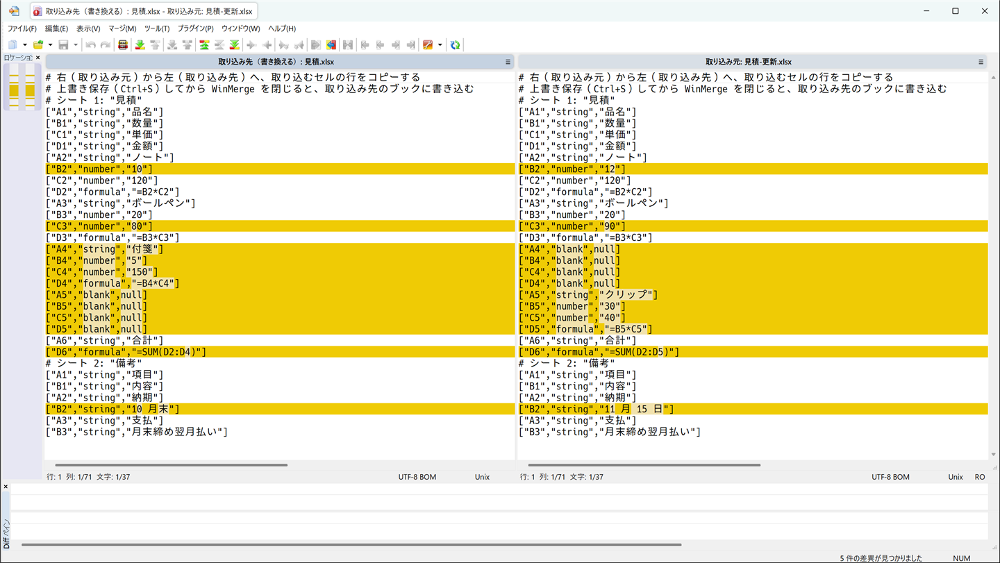
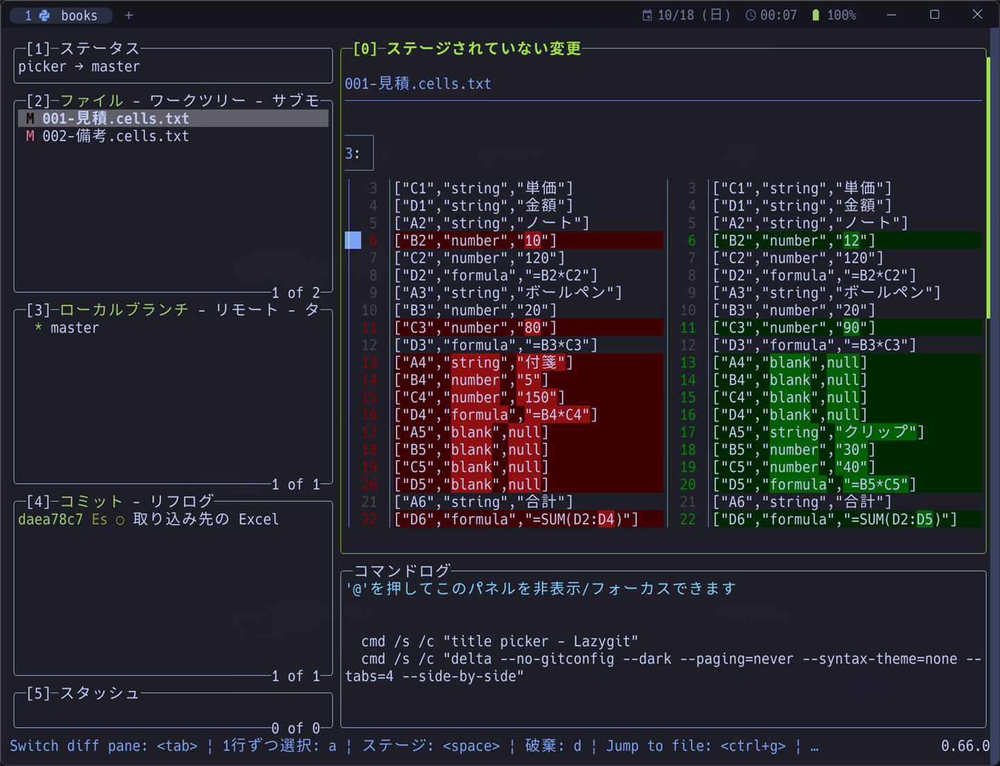
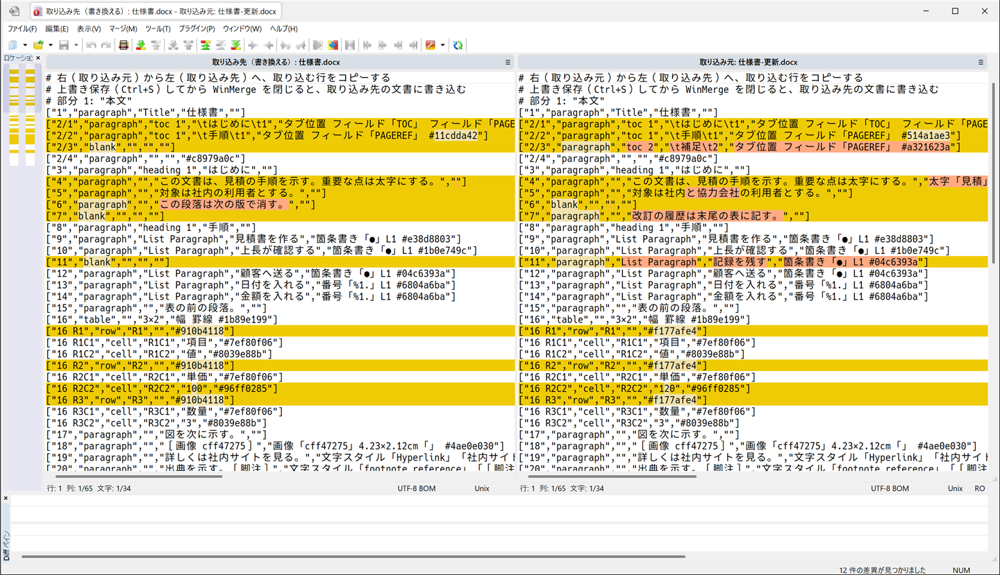
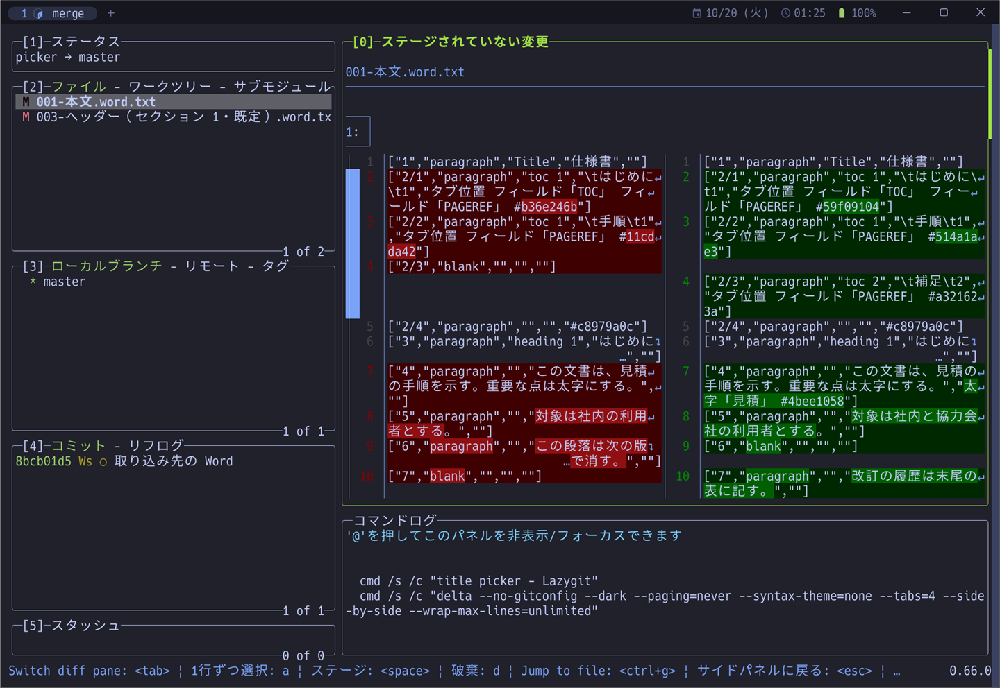
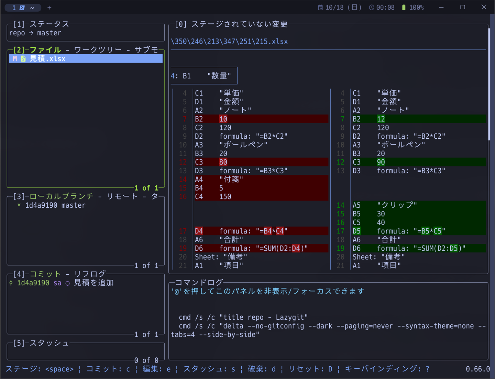
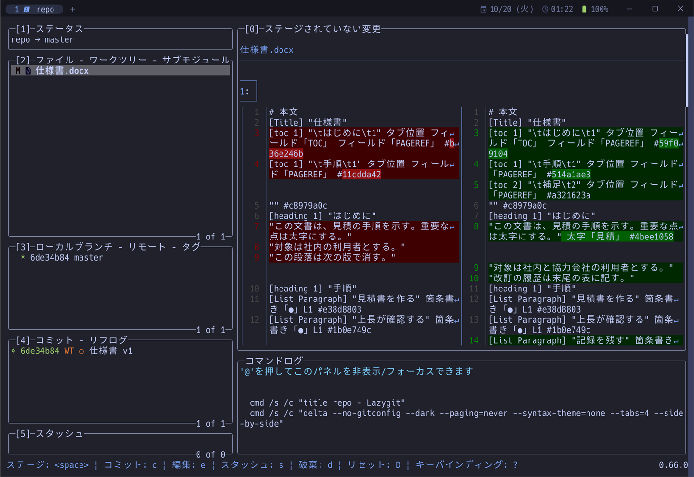

# excel-diff

Excel のブックと Word の文書を、セル・段落の単位のテキストにして Git の差分に表示し、lazygit の `E` で選んだ変更だけを部分ステージする道具です。任意の 2 つのブック・文書を比べ、WinMerge または lazygit で選んだ変更を一方へ取り込むこともできます。

lazygit の設定は [ryo-aoki-pc/lazygit](https://github.com/ryo-aoki-pc/lazygit) にあります。その設定の `E` のキーが、このリポジトリの導入スクリプトで登録する `git excel-stage` を呼びます。

## 導入

AlmaLinux 10 と Windows 11 の自分のユーザーを対象にしています。導入・更新と使い方は、setup-notes の次の項を参照してください。macOS は[仕様と検査の「macOS の導入」](docs/reference/readme.md#macos-の導入)にあります。

| 用途 | AlmaLinux 10 | Windows 11 |
| --- | --- | --- |
| 導入・更新 | [手順](https://github.com/ryo-aoki-pc/setup-notes/blob/main/docs/almalinux-setup.md#excel-diff-を導入更新する) | [手順](https://github.com/ryo-aoki-pc/setup-notes/blob/main/docs/windows-setup.md#excel-diff-を導入更新する) |
| 差分を確かめる（Excel） | [手順](https://github.com/ryo-aoki-pc/setup-notes/blob/main/docs/almalinux-setup.md#lazygit-で-excel-の差分を確かめる) | [手順](https://github.com/ryo-aoki-pc/setup-notes/blob/main/docs/windows-setup.md#lazygit-で-excel-の差分を確かめる) |
| 部分ステージ（Excel） | [手順](https://github.com/ryo-aoki-pc/setup-notes/blob/main/docs/almalinux-setup.md#lazygit-で-excel-のセル変更を部分ステージする) | [手順](https://github.com/ryo-aoki-pc/setup-notes/blob/main/docs/windows-setup.md#lazygit-で-excel-のセル変更を部分ステージする) |
| 2 つのブックの取り込み（Excel） | [手順](https://github.com/ryo-aoki-pc/setup-notes/blob/main/docs/almalinux-setup.md#lazygit-で-2-つの-excel-のセルの変更を取り込む) | [手順](https://github.com/ryo-aoki-pc/setup-notes/blob/main/docs/windows-setup.md#winmerge-で-2-つの-excel-のセルの変更を取り込む) |
| 大きいブックの変換を待つ（Excel） | [手順](https://github.com/ryo-aoki-pc/setup-notes/blob/main/docs/almalinux-setup.md#lazygit-で大きな-excel-の変換を待つ) | [手順](https://github.com/ryo-aoki-pc/setup-notes/blob/main/docs/windows-setup.md#lazygit-で大きな-excel-の変換を待つ) |
| 差分を確かめる（Word） | [手順](https://github.com/ryo-aoki-pc/setup-notes/blob/main/docs/almalinux-setup.md#lazygit-で-word-の差分を確かめる) | [手順](https://github.com/ryo-aoki-pc/setup-notes/blob/main/docs/windows-setup.md#lazygit-で-word-の差分を確かめる) |
| 部分ステージ（Word） | [手順](https://github.com/ryo-aoki-pc/setup-notes/blob/main/docs/almalinux-setup.md#lazygit-で-word-の変更を部分ステージする) | [手順](https://github.com/ryo-aoki-pc/setup-notes/blob/main/docs/windows-setup.md#lazygit-で-word-の変更を部分ステージする) |
| 2 つの文書の取り込み（Word） | [手順](https://github.com/ryo-aoki-pc/setup-notes/blob/main/docs/almalinux-setup.md#lazygit-で-2-つの-word-の変更を取り込む) | [手順](https://github.com/ryo-aoki-pc/setup-notes/blob/main/docs/windows-setup.md#winmerge-で-2-つの-word-の変更を取り込む) |
| 戻す | [手順](docs/extra/readme.md#almalinux-10-のロールバック) | [手順](docs/extra/readme.md#windows-11-のロールバック) |

## 2 つのブックのセルを取り込む

```sh
git excel-merge -- "取り込み先.xlsx" "取り込み元.xlsx"
```

書き換えるのは最初の引数（取り込み先）です。取り込み元は変更しません。Git のリポジトリの外でも使えます。値と通常の数式を取り込み、書式・画像・マクロは取り込み先のものを保ちます。上書き前のバックアップは作りません。

既定の `--tool auto` は、Windows で WinMerge が見つかれば WinMerge、それ以外では lazygit を選びます。`--tool winmerge` または `--tool lazygit` で指定することもできます。

- WinMerge は左が取り込み先、右が取り込み元です。取り込むセルの行を右から左へコピーし、上書き保存（`Ctrl+S`）してから窓を閉じます。
- lazygit は専用画面で `Enter` → `Space` でハンクを選び、`X` で取り込み先へ書き込みます。書き込む前に `q` で閉じると取り消します。

**WinMerge** — 左が取り込み先（見出しに「取り込み先（書き換える）」）、右が取り込み元（読み取り専用）。色の付いた行がセルの違いで、右から左へコピーした行のセルを取り込みます（Windows 11 の WinMerge 2.16.58.2 で、試験用のブックを開いた画面）。



**lazygit** — 左が取り込み先、右が取り込み元のセル。`Enter` → `Space` でステージしたハンクのセルを、`X` で取り込み先へ書き込みます（同じブックを Windows 11 の lazygit 0.66.0・delta 0.20.1 で開いた画面）。



操作の手順は「導入」の表から、[取り込みの仕様](docs/reference/readme.md#2-つのブックの取り込み)と[注意点](docs/extra/readme.md#取り込みの注意点)は各文書を参照してください。

## 2 つの Word 文書の変更を取り込む

```sh
git word-merge -- "取り込み先.docx" "取り込み元.docx"
```

書き換えるのは最初の引数（取り込み先）です。取り込み元は変更しません。Git のリポジトリの外でも使えます。選んだ段落・セル・表・ヘッダー・フッターの変更を取り込み、新しい画像・外部リンク・スタイル・箇条書きと段落番号の定義も一緒に写します。選ばなかった部分は取り込み先のものを保ちます。上書き前のバックアップは作りません。

コメント・脚注の参照・図形など、取り込めない違いは理由を端末に出し、画面では選べません。取り込み先を Word で開いている場合は、閉じてから取り込んでください。

既定の `--tool auto` は、Windows で WinMerge が見つかれば WinMerge、それ以外では lazygit を選びます。`--tool winmerge` または `--tool lazygit` で指定することもできます。

- WinMerge は左が取り込み先、右が取り込み元です。取り込む行全体を右から左へコピーし、上書き保存（`Ctrl+S`）してから窓を閉じます。
- lazygit は専用画面で `Enter` → `Space` でハンクを選び、`X` で取り込み先へ書き込みます。書き込む前に `q` で閉じると取り消します。

**WinMerge** — 左が取り込み先（見出しに「取り込み先（書き換える）」）、右が取り込み元（読み取り専用）。`# 部分 1: "本文"` などの見出しの後ろに段落・表・セルの行が並び、色の付いた行が違いです。右から左へコピーした行の変更を取り込みます（Windows 11 の WinMerge 2.16.58.2 で、試験用の文書を開いた画面）。



**lazygit** — 本文・ヘッダー・フッターごとのファイルで、左が取り込み先、右が取り込み元の行。`Enter` → `Space` でステージしたハンクの変更を、`X` で取り込み先へ書き込みます（同じ文書を Windows 11 の lazygit 0.66.0・delta 0.20.1 で開いた画面）。



操作の手順は「導入」の表から、[Word の取り込みの仕様](docs/reference/readme.md#2-つの-word-文書の取り込み)と[Word の注意点](docs/extra/readme.md#word-の注意点)は各文書を参照してください。

## 表示の例

売上シートの `B2` を `1000` から `1200` に変えると、Git の差分は次のようになります。delta では削除側と追加側が左右に並びます。

```diff
 Sheet: "売上"
 A1	"金額"
-B2	1000
+B2	1200
 C2	formula: "=B2*1.1"
```

lazygit では、Git のリポジトリの中の変更したブックを選ぶと、セルの差分が delta の左右比較で出ます（Windows 11 の lazygit 0.66.0・delta 0.20.1、試験用のブック）。



Word の文書は、段落を 1 行にして比べます。文字の変更に加えて、文字が同じでも太字などの書式を変えると差分が出ます。たとえば「見積」を太字にし、次の段落の文字を変え、その次の段落を消して別の段落を足すと、差分の一部は次のようになります。行末の書式の要約と `#` で始まる目印が、書式の違いを表します。

```diff
 [heading 1] "はじめに"
-"この文書は、見積の手順を示す。重要な点は太字にする。"
-"対象は社内の利用者とする。"
-"この段落は次の版で消す。"
+"この文書は、見積の手順を示す。重要な点は太字にする。" 太字「見積」 #4bee1058
+"対象は社内と協力会社の利用者とする。"
+"改訂の履歴は末尾の表に記す。"
 [heading 1] "手順"
```

lazygit では、変更した文書を選ぶと、段落の差分が delta の左右比較で出ます（Windows 11 の lazygit 0.66.0・delta 0.20.1、試験用の文書）。



## 文書

- [仕様と検査](docs/reference/readme.md) — Excel・Word の表示内容・部分ステージと取り込みの仕様・自動検証・macOS の導入
- [注意点とロールバック](docs/extra/readme.md) — Excel・Word の対応条件と制限・取り込みの注意点・戻す手順
- [検証記録](https://github.com/ryo-aoki-pc/setup-notes-verification/blob/main/repos/excel-diff/docs/verification/readme.md)（非公開） — 実施日・環境・結果・未確認の範囲
- [AGENTS.md](AGENTS.md) — テストのコマンドと、変えるときの決まり
