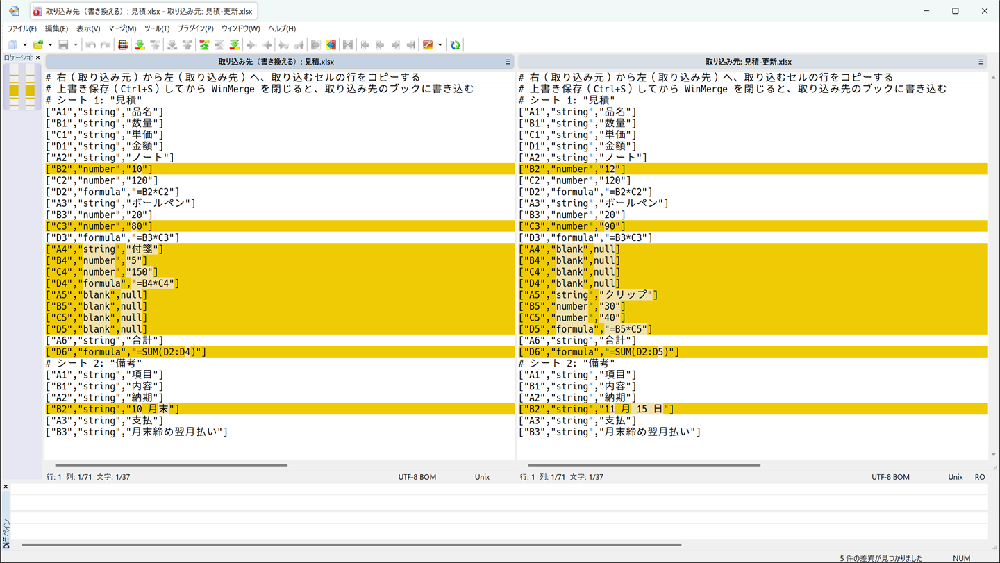
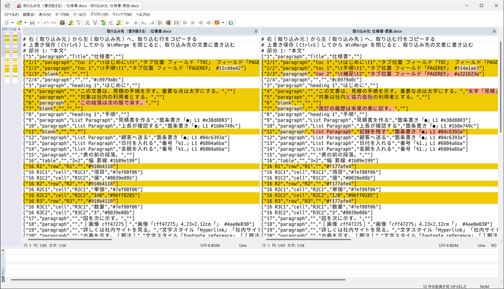

# excel-diff の使い方（AlmaLinux 10・Windows 11）

- Excel のブックと Word の文書の差分表示・部分ステージ・2 つのファイルの取り込みに使う道具（[excel-diff](../README.md)）
- 導入と更新は [excel-diff の導入と更新](install.md) にある
- どの項も単独で通せる。項のリードの前提を先に満たす
- bash のブロックはブラケットペーストの効く端末に、PowerShell のブロックは PowerShell 7 に貼り、貼った後に Enter を押す。貼り方と、反転表示の「確認」から後ろの出力の読み方は、setup-notes の [AlmaLinux 10 のセットアップ](https://github.com/ryo-aoki-pc/setup-notes/blob/main/docs/almalinux-setup.md) と [Windows 11 のセットアップ](https://github.com/ryo-aoki-pc/setup-notes/blob/main/docs/windows-setup.md) の冒頭に従う

<details id="この文書の補足と注意点">
  <summary>この文書の補足と注意点</summary>

**参照**

- 検証記録（setup-notes-verification の `docs/verification/almalinux-setup.md`）
- 検証記録（setup-notes-verification の `docs/verification/windows-setup.md`）

</details>

## AlmaLinux 10 で使う

- GNOME にログインした自分のユーザーで行う。前提の setup-notes の項は、各項のリードのリンクから開く

### lazygit で Excel の差分を確かめる

- Excel のブックのある Git リポジトリで、ブックの差分がシートとセル番地の付いたテキストで出ることを確かめる
- 前提: [excel-diff を導入・更新する](install.md#excel-diff-を導入更新する)を通してある
- 実行場所: GNOME にログインした自分のユーザーの端末（bash。`sudo` は使わない）の、ブックのある Git リポジトリのディレクトリ。[WezTerm](https://github.com/ryo-aoki-pc/setup-notes/blob/main/docs/shell-terminal.md#wezterm)を通したなら、WezTerm のタブ

1. Excel のある Git リポジトリで差分を確かめる（`売上表.xlsx` は実際のファイル名）。

   ```bash
   printf '\n\033[7m 確認 \033[0m\n'
   # 差分変換の属性を確かめる
   git check-attr diff -- "売上表.xlsx"
   # 作業ツリーとインデックスの差分を表示する
   git diff -- "売上表.xlsx"
   git diff --cached -- "売上表.xlsx"
   ```

   - 最初に `売上表.xlsx: diff: excel` が出て、差分に `Sheet:` とセル番地が出ればよい
   - 日本語のファイル名が引用符と 8 進数で出ても、同じファイル
   - lazygit を開き直してファイルを選ぶと delta で表示する。`|` の内蔵表示でも Excel のテキスト差分が出る
   - `unset` や別のドライバーが出たら、そのリポジトリの `.gitattributes`・`.git/info/attributes` を確認する
   - そのリポジトリだけに設定するなら、`.git/info/attributes` に `*.[xX][lL][sS][xX] diff=excel` を足す
   - 全体をステージするには、lazygit の**ファイル一覧で `Space`** を押す
   - **通常差分の `Enter` から行・ハンクのステージや破棄を行わない**。既存 Excel にはパッチを適用できず、新規ファイルはテキストをステージしてしまう場合がある
   - `diff.excel.binary=true` でも、この操作は禁止されない。部分ステージは[専用画面](#lazygit-で-excel-のセル変更を部分ステージする)の `E` で行う

<details id="lazygit-で-excel-の差分を確かめる-の補足と注意点">
  <summary>lazygit で Excel の差分を確かめる の補足と注意点</summary>

**[lazygit で Excel の差分を確かめる](#lazygit-で-excel-の差分を確かめる)の手順 1**

- 表示する内容は[Excel 差分の仕様](reference/readme.md#表示する内容)、属性の優先順位と制限は[注意点](extra/readme.md#注意点)を参照する

- Git の `core.quotePath` が既定の `true` なら、日本語のファイル名は `"\345\243\262\344\270\212\350\241\250.xlsx": diff: excel` のように引用符と 8 進数で出る（同じファイル）

</details>

---

### lazygit で Excel のセル変更を部分ステージする

- lazygit の専用画面で、Excel のブックのセルの変更を選んで index に入れる
- 前提: [lazygit](https://github.com/ryo-aoki-pc/setup-notes/blob/main/docs/almalinux-setup.md#lazygit)・[git-delta](https://github.com/ryo-aoki-pc/setup-notes/blob/main/docs/almalinux-setup.md#git-delta)・[excel-diff を導入・更新する](install.md#excel-diff-を導入更新する)を通してある（lazygit 0.66.0 以上・delta 0.20.1 以上）
- 実行場所: GNOME にログインした自分のユーザーの端末（bash。`sudo` は使わない）で、ブックのある Git リポジトリを開いた lazygit。[WezTerm](https://github.com/ryo-aoki-pc/setup-notes/blob/main/docs/shell-terminal.md#wezterm)を通したなら、WezTerm のタブ
- 対象は HEAD と index にある既存 `.xlsx` / `.xlsm` / `.xltx` / `.xltm` / `.xlam` / `.xlsb`
- 新規ファイルは全体をコミットしてから使う

1. lazygit のファイル一覧で対象を選び、`E` を押す。

   - 端末から開くなら `git excel-stage -- "売上表.xlsx"`。実際のファイル名に置き換える
   - 専用画面が開くまで待つ。大きいブックでは「Excel を読み込んでいます」と出る

1. 専用画面で `Enter` → `Space` を押してハンクを選ぶ。

   - 左右の矢印で移動し、ステージ済み差分を確認する
   - 値・通常の数式は `.cells.txt`、セルの書式（表示形式・フォント・塗りつぶし・罫線・配置・保護・セルのスタイル）は `.formats.txt` のハンクで選ぶ。同じセルの値と書式は別々に選べる。置換は削除・追加の両方を選ぶ
   - 行の高さ・列の幅・条件付き書式・画像・マクロ・行列の挿入や移動を反映する場合は、元のファイル一覧で全体をステージする
   - 対応できない変更は index を変更せず中断する。[対応条件と制限](extra/readme.md)を確認する

1. 選択を確認して専用画面の `X` で適用し、`q` で戻る。

   - `X` の前に `q` で閉じれば選択を取り消す
   - 作業中の Excel は変えず、選ばなかったセルの書式と、画像・マクロは index 側のものを保持する
   - 開いた後に対象の index・作業ファイルが変わった場合は中断する。閉じて `E` から開き直す
   - 選んだ文字列セルのふりがなは引き継がない。未選択のセルは保持する
   - 値・数式を選んだときは、次に Excel で開いたときに再計算する。スクリプトはマクロ・外部リンク更新・数式再計算を実行しない

---

### lazygit で大きな Excel の変換を待つ

- 大きなブックの差分を、全セルの変換が終わるまで待ってから出す
- 前提: [excel-diff を導入・更新する](install.md#excel-diff-を導入更新する)を通してある
- 実行場所: GNOME にログインした自分のユーザーの端末（bash。`sudo` は使わない）の、ブックのある Git リポジトリのディレクトリ。[WezTerm](https://github.com/ryo-aoki-pc/setup-notes/blob/main/docs/shell-terminal.md#wezterm)を通したなら、WezTerm のタブ

1. 全セルの変換を待って差分を表示する（`売上表.xlsx` は実際のファイル名）。

   ```bash
   EXCEL_TEXTCONV_TIMEOUT=0 git diff -- "売上表.xlsx"
   ```

   - 通常の変換中のブックは、完了後に選び直すか `R` で表示する

<details id="lazygit-で大きな-excel-の変換を待つ-の補足と注意点">
  <summary>lazygit で大きな Excel の変換を待つ の補足と注意点</summary>

**[lazygit で大きな Excel の変換を待つ](#lazygit-で大きな-excel-の変換を待つ)の手順 1**

- この環境変数は、このコマンドにだけ適用する

</details>

---

### lazygit で 2 つの Excel のセルの変更を取り込む

- 2 つのブックを比べ、取り込み元のセルの値・通常の数式・セルの書式を選んで取り込み先へ書き込む
- 前提: [excel-diff を導入・更新する](install.md#excel-diff-を導入更新する)・[lazygit](https://github.com/ryo-aoki-pc/setup-notes/blob/main/docs/almalinux-setup.md#lazygit)・[git-delta](https://github.com/ryo-aoki-pc/setup-notes/blob/main/docs/almalinux-setup.md#git-delta)を通してある（lazygit 0.66.0 以上・delta 0.20.1 以上）
- 実行場所: GNOME にログインした自分のユーザーの端末（bash。`sudo` は使わない）。[WezTerm](https://github.com/ryo-aoki-pc/setup-notes/blob/main/docs/shell-terminal.md#wezterm)を通したなら、WezTerm のタブ。Git リポジトリの外でも使える
- 書き換えるのは最初に指定する取り込み先で、`.bak` は作らない。取り込み先を Excel などで開いていたら閉じておく
- 対象は両方とも `.xlsx` / `.xlsm` / `.xltx` / `.xltm` / `.xlam` / `.xlsb` で、シートの構成が同じブック
- xlsb 同士、または xlsx 系（`.xlsx` / `.xlsm` / `.xltx` / `.xltm` / `.xlam`）同士を指定する
- 対応条件と制限は[excel-diff の注意点](extra/readme.md#注意点)を確認する

1. 変数を設定する（`EXCEL_TARGET`・`EXCEL_SOURCE` は必ず値を入れる）。

   ```bash
   EXCEL_TARGET=''                       # ← 取り込み先（書き換えるブック）の絶対パス
   ```

   ```bash
   EXCEL_SOURCE=''                       # ← 取り込み元のブックの絶対パス
   ```

   ```bash
   printf '\n\033[7m 確認 \033[0m\n'
   printf 'EXCEL_TARGET = %s\nEXCEL_SOURCE = %s\n' "$EXCEL_TARGET" "$EXCEL_SOURCE"
   ```

   - 取り込み先と取り込み元の絶対パスを読み戻して確かめる
   - 新しい端末を開いたら、この項の手順 1 を貼り直してから先へ進む

1. 2 つのブックを比べる専用画面を開く。

   ```bash
   # 取り込み先と取り込み元を指定してブックを開く
   if [ -z "$EXCEL_TARGET" ] || [ -z "$EXCEL_SOURCE" ]; then
     echo '中断: この項の手順 1 の EXCEL_TARGET または EXCEL_SOURCE が空のまま' >&2
   else
     git excel-merge -- "$EXCEL_TARGET" "$EXCEL_SOURCE"
   fi
   ```

   - 「書き換えるファイル: …」「取り込み元: …」が指定したパスであることを確かめる
   - 「差分がありません。取り込み先は変えていません。」または「取り込める差分がありません（取り込めない違い N セル）。取り込み先は変えていません。」が出たら、この項の手順 3 は飛ばす
   - 「取り込めない違い（N セル）: …」が出たら、一覧のセルは選べない
   - 「Excel の取り込みに失敗しました: …」が出たら、理由を確かめてからやり直す
   - **次の手順は、専用画面で行う**

1. 専用画面でハンクを選び、取り込み先へ書き込んで閉じる。

   - `Enter` → `Space` を押してハンクを選び、左右の矢印で移動して選択を確かめる。置換は削除・追加の両方を選ぶ
   - 値・数式は `.cells.txt`、セルの書式は `.formats.txt` で選ぶ。同じセルの値と書式は別々に選べる
   - `X` で書き込み、「N セルを取り込み先へ書き込みました。q で元の画面へ戻ってください。」が出たら `q` で閉じる。書式も選んだときは「値 N セル・書式 M セルを…」（書式だけなら「書式 M セルを…」）と出る
   - `X` の前に `q` で閉じれば選択を取り消し、「取り込むセルが選ばれていません。取り込み先は変えていません。」が出る
   - 「セル変更が選択されていません。Enter・Space でハンクを選び、X で反映してください。」が出たら、ハンクを選んで `X` を押す
   - 取り込み先を Excel などで開いたために書き込めなければ、閉じて `X` を押し直す
   - 専用画面を閉じると、端末に「N セルを取り込み先へ書き込みました: …」（書式も取り込んだときは「値 N セル・書式 M セルを取り込み先へ書き込みました: …」、書式だけなら「書式 M セルを取り込み先へ書き込みました: …」）が出ればよい

<details id="lazygit-で-2-つの-excel-のセルの変更を取り込む-の補足と注意点">
  <summary>lazygit で 2 つの Excel のセルの変更を取り込む の補足と注意点</summary>

**[lazygit で 2 つの Excel のセルの変更を取り込む](#lazygit-で-2-つの-excel-のセルの変更を取り込む)の手順 2**

- 端末に「書き換えるファイル: …」「取り込み元: …」が出て、専用画面が開く

</details>

---

### lazygit で Word の差分を確かめる

- Word の文書のある Git リポジトリで、文書の差分が段落ごとのテキストで出ることを確かめる
- 前提: [excel-diff を導入・更新する](install.md#excel-diff-を導入更新する)を通してある
- 実行場所: GNOME にログインした自分のユーザーの端末（bash。`sudo` は使わない）の、文書のある Git リポジトリのディレクトリ。[WezTerm](https://github.com/ryo-aoki-pc/setup-notes/blob/main/docs/shell-terminal.md#wezterm)を通したなら、WezTerm のタブ
- 対象は Transitional の OOXML の `.docx` / `.docm` / `.dotx` / `.dotm`。暗号化・`.doc`・Strict は表示しない

1. Word のある Git リポジトリで差分を確かめる（`仕様書.docx` は実際のファイル名）。

   ```bash
   printf '\n\033[7m 確認 \033[0m\n'
   # Word 用の差分変換の属性を確かめる
   git check-attr diff -- "仕様書.docx"
   # 作業ツリーとインデックスの差分を表示する
   git diff -- "仕様書.docx"
   git diff --cached -- "仕様書.docx"
   ```

   - 最初に `仕様書.docx: diff: word` が出て、差分に `# 本文` と段落の行が出ればよい
   - 日本語のファイル名が引用符と 8 進数で出ても、同じファイル
   - lazygit を開き直してファイルを選ぶと delta で表示する。`|` の内蔵表示でも Word のテキスト差分が出る
   - `unset` や別のドライバーが出たら、そのリポジトリの `.gitattributes`・`.git/info/attributes` を確認する
   - そのリポジトリだけに設定するなら、`.git/info/attributes` に `*.[dD][oO][cC][xX] diff=word` を足す
   - 全体をステージするには、lazygit の**ファイル一覧で `Space`** を押す
   - **通常差分の `Enter` から行・ハンクのステージや破棄を行わない**。既存 Word にはパッチを適用できず、新規ファイルはテキストをステージしてしまう場合がある
   - `diff.word.binary=true` でも、この操作は禁止されない。部分ステージは[専用画面](#lazygit-で-word-の変更を部分ステージする)の `E` で行う
   - 大きい文書の変換を待つなら、[lazygit で大きな Excel の変換を待つ](#lazygit-で大きな-excel-の変換を待つ)と同じ環境変数 `EXCEL_TEXTCONV_TIMEOUT` を使い、ファイル名を対象の Word に置き換える

<details id="lazygit-で-word-の差分を確かめる-の補足と注意点">
  <summary>lazygit で Word の差分を確かめる の補足と注意点</summary>

**[lazygit で Word の差分を確かめる](#lazygit-で-word-の差分を確かめる)の手順 1**

- 表示する内容は[Word の表示の仕様](reference/readme.md#word-の表示)、属性の優先順位は[注意点](extra/readme.md#注意点)、Word の制限は[Word の注意点](extra/readme.md#word-の注意点)を参照する

- Git の `core.quotePath` が既定の `true` なら、日本語のファイル名は `"\344\273\225\346\247\230\346\233\270.docx": diff: word` のように引用符と 8 進数で出る（同じファイル）

</details>

---

### lazygit で Word の変更を部分ステージする

- lazygit の専用画面で、Word の文書の段落・表・書式などの変更を選んで index に入れる
- 前提: [lazygit](https://github.com/ryo-aoki-pc/setup-notes/blob/main/docs/almalinux-setup.md#lazygit)・[git-delta](https://github.com/ryo-aoki-pc/setup-notes/blob/main/docs/almalinux-setup.md#git-delta)・[excel-diff を導入・更新する](install.md#excel-diff-を導入更新する)を通してある（lazygit 0.66.0 以上・delta 0.20.1 以上）
- 実行場所: GNOME にログインした自分のユーザーの端末（bash。`sudo` は使わない）で、文書のある Git リポジトリを開いた lazygit。[WezTerm](https://github.com/ryo-aoki-pc/setup-notes/blob/main/docs/shell-terminal.md#wezterm)を通したなら、WezTerm のタブ
- 対象は HEAD と index にある既存 `.docx` / `.docm` / `.dotx` / `.dotm`
- 新規ファイルは全体をコミットしてから使う
- 対象は Transitional の OOXML。暗号化・`.doc`・Strict・電子署名付きの文書は部分ステージしない
- 選べる単位と選べない違いは excel-diff の[Word の部分ステージ](reference/readme.md#word-の部分ステージ)、制限は[Word の注意点](extra/readme.md#word-の注意点)を参照する

1. lazygit のファイル一覧で対象を選び、`E` を押す。

   - 端末から開くなら `git word-stage -- "仕様書.docx"`。実際のファイル名に置き換える
   - 「Word を読み込んでいます。大きい文書では選択画面が開くまで時間がかかります。」が出たら、専用画面が開くまで待つ

1. 専用画面で対象の部分を選び、`Enter` → `Space` を押してハンクを選ぶ。

   - ファイル一覧の `001-本文.word.txt` などから、対象の部分を選ぶ
   - 左右の矢印で移動し、ステージ済み差分を確認する
   - 段落・表・セクションの設定・ヘッダーとフッターの段落を選べる。置換は削除・追加の両方を選ぶ
   - 形が同じ表は、表の形・行・セルごとに選ぶ。行の追加などで形が変わった表と、目次など段落をまたぐフィールドは、まとまりの変更行をすべて選ぶ
   - 太字や色などの書式だけを反映するなら、書式の目印が異なる行を選ぶ
   - 「このまとまりの変更行をすべて選んでください。」で止まったら、そのまとまりの変更行をすべて選ぶ
   - コメント、脚注・文末脚注の参照、グラフ・図形など選べない違いは、元のファイル一覧で全体をステージする
   - 「段落単位で反映できません」で止まったら、表示された理由を確かめる。index は変わらない

1. 選択を確認して専用画面の `X` で適用し、`q` で戻る。

   - 「N か所の変更を Word のままステージしました。q で元の画面へ戻ってください。」が出ればよい
   - 目次などを選ぶと「目次などの参照先に合わせて、表示が同じ N か所を取り込み元のものにしました。」も出ることがある。表示が同じ段落を取り込み元のものにしただけで、文字は変わらない
   - `X` の前に `q` で閉じれば選択を取り消す
   - 作業中の Word は変えない
   - 「変更が選択されていません。Enter・Space でハンクを選び、X で反映してください。」が出たら、ハンクを選んで `X` を押す
   - 開いた後に対象の index・作業ファイルが変わった場合は中断する。閉じて `E` から開き直す
   - 目次・相互参照・文書内リンクの参照先が無くなると表示されたら、参照先の段落の変更も選ぶ

---

### lazygit で 2 つの Word の変更を取り込む

- 2 つの文書を比べ、取り込み元の段落・表・書式などの変更を選んで取り込み先へ書き込む
- 前提: [excel-diff を導入・更新する](install.md#excel-diff-を導入更新する)・[lazygit](https://github.com/ryo-aoki-pc/setup-notes/blob/main/docs/almalinux-setup.md#lazygit)・[git-delta](https://github.com/ryo-aoki-pc/setup-notes/blob/main/docs/almalinux-setup.md#git-delta)を通してある（lazygit 0.66.0 以上・delta 0.20.1 以上）
- 実行場所: GNOME にログインした自分のユーザーの端末（bash。`sudo` は使わない）。[WezTerm](https://github.com/ryo-aoki-pc/setup-notes/blob/main/docs/shell-terminal.md#wezterm)を通したなら、WezTerm のタブ。Git リポジトリの外でも使える
- 書き換えるのは最初に指定する取り込み先で、`.bak` は作らない。取り込み先を Word などで開いていたら閉じておく
- 対象は両方とも Transitional の OOXML の `.docx` / `.docm` / `.dotx` / `.dotm`。暗号化・`.doc`・Strict・電子署名付きの文書は取り込まない。対応条件と制限は[excel-diff の Word の注意点](extra/readme.md#word-の注意点)を確認する

1. 変数を設定する（`WORD_TARGET`・`WORD_SOURCE` は必ず値を入れる）。

   ```bash
   WORD_TARGET=''                       # ← 取り込み先（書き換える文書。例: 仕様書.docx）の絶対パス
   ```

   ```bash
   WORD_SOURCE=''                       # ← 取り込み元の文書（例: 仕様書-更新.docx）の絶対パス
   ```

   ```bash
   printf '\n\033[7m 確認 \033[0m\n'
   printf 'WORD_TARGET = %s\nWORD_SOURCE = %s\n' "$WORD_TARGET" "$WORD_SOURCE"
   ```

   - 取り込み先と取り込み元の絶対パスを読み戻して確かめる
   - 新しい端末を開いたら、この項の手順 1 を貼り直してから先へ進む

1. 2 つの文書を比べる専用画面を開く。

   ```bash
   # 取り込み先と取り込み元を指定して文書を開く
   if [ -z "$WORD_TARGET" ] || [ -z "$WORD_SOURCE" ]; then
     echo '中断: この項の手順 1 の WORD_TARGET または WORD_SOURCE が空のまま' >&2
   else
     printf '\n\033[7m 確認 \033[0m\n'
     git word-merge -- "$WORD_TARGET" "$WORD_SOURCE"
   fi
   ```

   - 「書き換えるファイル: …」「取り込み元: …」が指定したパスであることを確かめる
   - 「Word を読み込んでいます。大きい文書では画面が開くまで時間がかかります。」が出たら、画面が開くまで待つ
   - 「差分がありません。取り込み先は変えていません。」または「取り込める差分がありません（取り込めない違い N か所）。取り込み先は変えていません。」が出たら、この項の手順 3 は飛ばす
   - 「取り込めない違い（N か所）: …」が出たら、一覧の違いは選べない。コメント、脚注・文末脚注の参照、グラフ・図形などの違いがあるなら、その表示を確かめる
   - 「Word の取り込みに失敗しました: …」が出たら、理由を確かめてからやり直す
   - **次の手順は、専用画面で行う**

1. 専用画面でハンクを選び、取り込み先へ書き込んで閉じる。

   - `Enter` → `Space` を押してハンクを選び、左右の矢印で移動して選択を確かめる。置換は削除・追加の両方を選ぶ
   - 目次や、行を足した表など、`"2/1"` のように番号に `/` が付く行のまとまりは、まとまりの変更行をすべて選ぶ
   - `X` で書き込み、「N か所の変更を取り込み先へ書き込みました。q で元の画面へ戻ってください。」が出たら `q` で閉じる
   - 目次などを選ぶと「目次などの参照先に合わせて、表示が同じ N か所を取り込み元のものにしました。」も出ることがある。表示が同じ段落を取り込み元のものにしただけで、文字は変わらない
   - `X` の前に `q` で閉じれば選択を取り消し、「取り込む変更が選ばれていません。取り込み先は変えていません。」が出る
   - 「変更が選択されていません。Enter・Space でハンクを選び、X で反映してください。」が出たら、ハンクを選んで `X` を押す
   - 「このまとまりの変更行をすべて選んでください。」で止まったら、そのまとまりの変更行をすべて選んで `X` を押し直す
   - 取り込み先を LibreOffice などで開いたために書き込めなければ、閉じて `X` を押し直す
   - 専用画面を閉じると、端末に「N か所の変更を取り込み先へ書き込みました: …」が出ればよい

<details id="lazygit-で-2-つの-word-の変更を取り込む-の補足と注意点">
  <summary>lazygit で 2 つの Word の変更を取り込む の補足と注意点</summary>

**[lazygit で 2 つの Word の変更を取り込む](#lazygit-で-2-つの-word-の変更を取り込む)の手順 2**

- 端末に「書き換えるファイル: …」「取り込み元: …」が出て、専用画面が開く

</details>

---

## Windows 11 で使う

- この PC のデスクトップで、自分のユーザーが行う。前提の setup-notes の項は、各項のリードのリンクから開く

### Windows 11 の lazygit で Excel の差分を確かめる

- 対象の Git リポジトリの Excel の属性と差分を確かめる
- 前提: [Windows 11 で excel-diff を導入・更新する](install.md#windows-11-で-excel-diff-を導入更新する)を通してある。対象の Excel が Git のリポジトリにある
- 実行場所: この PC のデスクトップの管理者ではない PowerShell 7。この項の手順 1 で開く
- 例の `売上表.xlsx` は実際のファイル名に置き換える
- 表示する内容は[Excel 差分の仕様](reference/readme.md#表示する内容)、属性の優先順位と制限は[注意点](extra/readme.md#注意点)を参照する

> [!CAUTION]
> - **通常の Excel 差分は閲覧用。`Enter` から行・ハンクをステージ・破棄しない**。既存の Excel にテキストのパッチは適用できず、新規ファイルでは Excel の代わりに変換後のテキストをステージする場合がある
> - `diff.excel.binary=true` はバイナリ扱いを保つだけで、これらの操作を禁止しない
> - 全体をステージするならファイル一覧で `Space`、部分ステージは[Windows 11 の lazygit で Excel のセル変更を部分ステージする](#windows-11-の-lazygit-で-excel-のセル変更を部分ステージする)の `E` を使う

1. 管理者ではない PowerShell 7 を開く。

   - スタートメニューで「PowerShell」を探し、クリックして開く（「Windows PowerShell」ではない。「管理者として実行」にはしない）
   - 「PowerShell」が無ければ、[アプリを入れる](https://github.com/ryo-aoki-pc/setup-notes/blob/main/docs/windows-setup.md#アプリを入れる)の手順 6〜9 を通す

1. 作業場所の変数を設定する（`EXCEL_REPO` は必ず値を入れる）。

   ```powershell
   $EXCEL_REPO = ''                     # ← 対象の Excel がある Git のリポジトリの絶対パス。<EXCEL_REPO>
   ```

   ```powershell
   'EXCEL_REPO = {0}' -f $EXCEL_REPO
   ```

   - 最後に値を読み戻して確かめる
   - **新しい PowerShell を開いたら**、この項の手順 2 を貼り直してから先へ進む

1. 対象のリポジトリへ移る。

   ```powershell
   & {
     # Excel のリポジトリに移動する
     if (-not $EXCEL_REPO) { Write-Error '中断: この項の手順 2 の EXCEL_REPO が空のまま'; return }
     Set-Location -LiteralPath $EXCEL_REPO -ErrorAction Stop
     "`n$([char]27)[7m 確認 $([char]27)[0m"
     git rev-parse --show-toplevel
   }
   ```

   - 対象のリポジトリの場所が出ればよい。エラーが出たら先へ進まず、この項の手順 2 の場所を確かめる

1. Excel の属性と、作業中・ステージ済みの差分を確かめる。

   ```powershell
   "`n$([char]27)[7m 確認 $([char]27)[0m"
   # Excel の差分属性を確認する
   git check-attr diff -- "売上表.xlsx"
   # Excel の作業ツリーとステージの差分を確認する
   git diff -- "売上表.xlsx"
   git diff --cached -- "売上表.xlsx"
   ```

   - `売上表.xlsx: diff: excel` と、差分に `Sheet:`・セル番地が出ればよい
   - 日本語のファイル名が引用符と 8 進数で出ても、同じファイル
   - lazygit を開き直してファイルを選ぶと、同じ差分を delta で表示する。`|` で内蔵表示にしても同じテキスト差分になる
   - `unset` や別のドライバーなら、そのリポジトリの `.gitattributes`・`.git/info/attributes` の Excel 用の属性を確かめる
   - そのリポジトリだけに適用するなら、`.git/info/attributes` に `*.[xX][lL][sS][xX] diff=excel` を足す

<details id="windows-11-の-lazygit-で-excel-の差分を確かめる-の補足と注意点">
  <summary>Windows 11 の lazygit で Excel の差分を確かめる の補足と注意点</summary>

**[Windows 11 の lazygit で Excel の差分を確かめる](#windows-11-の-lazygit-で-excel-の差分を確かめる)の手順 4**

- Git の `core.quotePath` が既定の `true` なら、日本語のファイル名は `"\345\243\262\344\270\212\350\241\250.xlsx": diff: excel` のように出る

</details>

---

### Windows 11 の lazygit で Excel のセル変更を部分ステージする

- 対象の Git リポジトリで、Excel の値・通常の数式・セルの書式の変更を専用画面から部分ステージする
- 前提: [Windows 11 で excel-diff を導入・更新する](install.md#windows-11-で-excel-diff-を導入更新する)を通してある。対象は HEAD と index の両方にある既存 `.xlsx` / `.xlsm` / `.xltx` / `.xltm` / `.xlam` / `.xlsb`。新規ファイルは全体をコミットしてある
- 実行場所: この PC のデスクトップの管理者ではない PowerShell 7。この項の手順 1 で開く。その窓から起動する lazygit の画面も使う
- 例の `売上表.xlsx` は実際のファイル名に置き換える

1. 管理者ではない PowerShell 7 を開く。

   - スタートメニューで「PowerShell」を探し、クリックして開く（「Windows PowerShell」ではない。「管理者として実行」にはしない）
   - 「PowerShell」が無ければ、[アプリを入れる](https://github.com/ryo-aoki-pc/setup-notes/blob/main/docs/windows-setup.md#アプリを入れる)の手順 6〜9 を通す

1. 作業場所の変数を設定する（`EXCEL_REPO` は必ず値を入れる）。

   ```powershell
   $EXCEL_REPO = ''                     # ← 対象の Excel がある Git のリポジトリの絶対パス。<EXCEL_REPO>
   ```

   ```powershell
   'EXCEL_REPO = {0}' -f $EXCEL_REPO
   ```

   - 最後に値を読み戻して確かめる
   - **新しい PowerShell を開いたら**、この項の手順 2 を貼り直してから先へ進む

1. 対象のリポジトリへ移り、lazygit を起動する。

   ```powershell
   & {
     # Excel のリポジトリで lazygit を起動する
     if (-not $EXCEL_REPO) { Write-Error '中断: この項の手順 2 の EXCEL_REPO が空のまま'; return }
     Set-Location -LiteralPath $EXCEL_REPO -ErrorAction Stop
     lazygit
   }
   ```

   - lazygit のファイル一覧が開けばよい
   - **次の手順は、lazygit の画面で行う**

1. lazygit のファイル一覧で対象を選び、`E` を押す。

   - 端末から開くなら `git excel-stage -- "売上表.xlsx"`。実際のファイル名に置き換える
   - 専用画面が開くまで待つ。大きいブックでは「Excel を読み込んでいます」と出る

1. 専用画面で `Enter` → `Space` を押してハンクを選ぶ。

   - 左右の矢印で移動し、ステージ済み差分を確認する
   - 値・通常の数式は `.cells.txt`、セルの書式（表示形式・フォント・塗りつぶし・罫線・配置・保護・セルのスタイル）は `.formats.txt` のハンクで選ぶ。同じセルの値と書式は別々に選べる。置換は削除・追加の両方を選ぶ
   - 行の高さ・列の幅・条件付き書式・画像・マクロ・行列の挿入や移動を反映する場合は、元のファイル一覧で全体をステージする
   - 対応できない変更は index を変更せず中断する。[対応条件と制限](extra/readme.md)を確認する

1. 選択を確認して専用画面の `X` で適用し、`q` で戻る。

   - `X` の前に `q` で閉じれば選択を取り消す
   - 作業中の Excel は変えず、選ばなかったセルの書式と、画像・マクロは index 側のものを保持する
   - 開いた後に対象の index・作業ファイルが変わった場合は中断する。閉じて `E` から開き直す
   - 選んだ文字列セルのふりがなは引き継がない。未選択のセルは保持する
   - 値・数式を選んだときは、次に Excel で開いたときに再計算する。スクリプトはマクロ・外部リンク更新・数式再計算を実行しない
   - 専用画面から戻ったら、lazygit でも `q` を押して閉じる
   - **ほかのブロックは、lazygit を閉じて PowerShell に戻ってから貼る**（lazygit を開いたまま貼ると、lazygit への入力になる）

---

### Windows 11 の lazygit で大きな Excel の変換を待つ

- 大きい Excel の全セルの変換を待ち、差分を表示する
- 前提: [Windows 11 で excel-diff を導入・更新する](install.md#windows-11-で-excel-diff-を導入更新する)を通してある。対象の Excel が Git のリポジトリにある
- 実行場所: この PC のデスクトップの管理者ではない PowerShell 7。この項の手順 1 で開く
- 例の `売上表.xlsx` は実際のファイル名に置き換える
- lazygit で変換中のブックは、完了後にファイルを選び直すか `R` で表示する

1. 管理者ではない PowerShell 7 を開く。

   - スタートメニューで「PowerShell」を探し、クリックして開く（「Windows PowerShell」ではない。「管理者として実行」にはしない）
   - 「PowerShell」が無ければ、[アプリを入れる](https://github.com/ryo-aoki-pc/setup-notes/blob/main/docs/windows-setup.md#アプリを入れる)の手順 6〜9 を通す

1. 作業場所の変数を設定する（`EXCEL_REPO` は必ず値を入れる）。

   ```powershell
   $EXCEL_REPO = ''                     # ← 対象の Excel がある Git のリポジトリの絶対パス。<EXCEL_REPO>
   ```

   ```powershell
   'EXCEL_REPO = {0}' -f $EXCEL_REPO
   ```

   - 最後に値を読み戻して確かめる
   - **新しい PowerShell を開いたら**、この項の手順 2 を貼り直してから先へ進む

1. 対象のリポジトリへ移る。

   ```powershell
   & {
     # Excel のリポジトリに移動する
     if (-not $EXCEL_REPO) { Write-Error '中断: この項の手順 2 の EXCEL_REPO が空のまま'; return }
     Set-Location -LiteralPath $EXCEL_REPO -ErrorAction Stop
     "`n$([char]27)[7m 確認 $([char]27)[0m"
     git rev-parse --show-toplevel
   }
   ```

   - 対象のリポジトリの場所が出ればよい。エラーが出たら先へ進まず、この項の手順 2 の場所を確かめる

1. 全セルの変換を待って差分を表示する。

   ```powershell
   $env:EXCEL_TEXTCONV_TIMEOUT = "0"; git diff -- "売上表.xlsx"
   ```

   - 環境変数は同じ窓に残る。戻すときは `Remove-Item Env:EXCEL_TEXTCONV_TIMEOUT` を実行する

---

### WinMerge で 2 つの Excel のセルの変更を取り込む

- 2 つのブックを比べ、取り込み元のセルの値・通常の数式・セルの書式を選んで取り込み先へ書き込む
- 前提: [Windows 11 で excel-diff を導入・更新する](install.md#windows-11-で-excel-diff-を導入更新する)を通してある。WinMerge が要る。この項の手順 2 で、無ければ入れる
- 実行場所: この PC のデスクトップの管理者ではない PowerShell 7。この項の手順 1 で開く。WinMerge の操作も、この PC のデスクトップで行う
- 書き換えるのは最初に指定する取り込み先。`.bak` は作らない。取り込み先を Excel などで開いていたら、始める前に閉じておく
- 対象は両方とも `.xlsx` / `.xlsm` / `.xltx` / `.xltm` / `.xlam` / `.xlsb` で、シートの構成が同じブック
- xlsb 同士、または xlsx 系（`.xlsx` / `.xlsm` / `.xltx` / `.xltm` / `.xlam`）同士を指定する
- 対応条件と制限は excel-diff の[注意点](extra/readme.md#注意点)を参照する

1. 管理者ではない PowerShell 7 を開く。

   - スタートメニューで「PowerShell」を探し、クリックして開く（「Windows PowerShell」ではない。「管理者として実行」にはしない）
   - 「PowerShell」が無ければ、[アプリを入れる](https://github.com/ryo-aoki-pc/setup-notes/blob/main/docs/windows-setup.md#アプリを入れる)の手順 6〜9 を通す

1. WinMerge が無ければ winget で入れ、版を確かめる。

   ```powershell
   # WinMerge を導入する
   winget list --id WinMerge.WinMerge --exact --accept-source-agreements
   if ($LASTEXITCODE -ne 0) {
     winget install --exact --id WinMerge.WinMerge --source winget --scope user --accept-source-agreements --accept-package-agreements
   }
   "`n$([char]27)[7m 確認 $([char]27)[0m"
   winget list --id WinMerge.WinMerge --exact
   ```

   - `WinMerge.WinMerge` と版が出ればよい
   - 導入に失敗したり、最後の一覧に出なかったりしたら、先へ進まず winget の表示を確かめる

1. 変数を設定する（`EXCEL_TARGET`・`EXCEL_SOURCE` は必ず値を入れる）。

   ```powershell
   $EXCEL_TARGET = ''                   # ← 取り込み先（書き換えるブック）の絶対パス。<EXCEL_TARGET>
   ```

   ```powershell
   $EXCEL_SOURCE = ''                   # ← 取り込み元のブックの絶対パス。<EXCEL_SOURCE>
   ```

   ```powershell
   "`n$([char]27)[7m 確認 $([char]27)[0m"
   'EXCEL_TARGET = {0}' -f $EXCEL_TARGET
   'EXCEL_SOURCE = {0}' -f $EXCEL_SOURCE
   ```

   - 最後に値を読み戻し、取り込み先と取り込み元が意図した絶対パスか確かめる
   - **新しい PowerShell を開いたら**、この項の手順 3 を貼り直してから先へ進む

1. 取り込み先と取り込み元を指定し、WinMerge を開く。

   ```powershell
   & {
     # Excel のブックの比較と取り込みを開始する
     if (-not $EXCEL_TARGET -or -not $EXCEL_SOURCE) { Write-Error '中断: この項の手順 3 の EXCEL_TARGET・EXCEL_SOURCE が空のまま'; return }
     git excel-merge -- $EXCEL_TARGET $EXCEL_SOURCE
   }
   ```

   - `書き換えるファイル: …`・`取り込み元: …` のパスを確かめる。端末は WinMerge を閉じるまで待つ
   - `取り込めない違い（N セル）: …` が出たら、そのセルは選べない。リードの注意点を確かめる
   - `差分がありません。取り込み先は変えていません。` か `取り込める差分がありません（取り込めない違い N セル）。取り込み先は変えていません。` なら画面は開かずに終わる
   - lazygit の専用画面で選ぶときは、この項の手順 4 のコマンドの `--` の前に `--tool lazygit` を付ける。lazygit 0.66.0 以上・delta 0.20.1 以上が要る
   - 専用画面では `Enter` → `Space` でハンクを選び、`X` で書き込み、`q` で閉じる。値・数式は `.cells.txt`、セルの書式は `.formats.txt` で選ぶ。置換は削除・追加の両方を選ぶ。`X` の前に `q` なら取り消す
   - lazygit の専用画面で取り込んだら、この項の手順 5 は飛ばす
   - WinMerge が開いたら、**次の手順は、WinMerge の画面で行う**

1. WinMerge で取り込む行を右から左へコピーし、上書き保存して窓を閉じる。

   - 左が取り込み先、右が取り込み元。「マージ」メニューの「次の差異」（`Alt+↓`）で移り、取り込む行を「左側にコピー」（`Alt+←`）する
   - セルの書式の違いは、各シートの値の行の後ろの `# 書式 シート N: …` の見出しの下に出る。書式の行も、取り込むものを右から左へコピーする。同じセルの値と書式は別々にコピーできる
   - 違いを全部取り込むときは、「マージ」メニューの「すべてを左側にコピー」を選び、`本当にすべての差異を他のファイルにコピーしますか?` に「はい」、`選択されたファイルは同一です。` に「OK」を押す。取り込めない違いのセルは、取り込み先の値・書式のまま残る
   - 左の見出しの行・書式の行の間の空行・値を手で書き換えない
   - 上書き保存（`Ctrl+S`）してから WinMerge の窓を閉じる。保存せずに閉じれば取り込み先は変わらない
   - 閉じると端末に `N セルを取り込み先へ書き込みました: …` が出ればよい。書式も取り込んだときは `値 N セル・書式 M セルを取り込み先へ書き込みました: …`（書式だけなら `書式 M セルを…`）と出る
   - 何も選ばなければ `取り込むセルが選ばれていません。取り込み先は変えていません。` と出る
   - `Excel の取り込みに失敗しました: …` で止まったら、表示された理由を確かめる
   - `WinMerge を開き直して直しますか [y/N]:` と聞かれたら、直す場合は `y`、中止する場合は `N` か Enter を押す
   - `取り込み先を閉じてから Enter で再試行します（q で中止）:` と聞かれたら、Excel などを閉じて Enter、取り消すなら `q` を押す
   - 

<details id="winmerge-で-2-つの-excel-のセルの変更を取り込む-の補足と注意点">
  <summary>WinMerge で 2 つの Excel のセルの変更を取り込む の補足と注意点</summary>

**[WinMerge で 2 つの Excel のセルの変更を取り込む](#winmerge-で-2-つの-excel-のセルの変更を取り込む)のリード**

- [WinMerge で 2 つの Excel のセルの変更を取り込む](#winmerge-で-2-つの-excel-のセルの変更を取り込む)の手順 5 の画像は、Windows 11 の実機の WinMerge 2.16.58.2 で撮った。ブック（`見積.xlsx`・`見積-更新.xlsx`）と値は試験用

</details>

---

### Windows 11 の lazygit で Word の差分を確かめる

- 対象の Git リポジトリの Word の属性と差分を確かめる
- 前提: [Windows 11 で excel-diff を導入・更新する](install.md#windows-11-で-excel-diff-を導入更新する)を通してある。対象の Word が Git のリポジトリにある
- 実行場所: この PC のデスクトップの管理者ではない PowerShell 7。この項の手順 1 で開く
- 例の `仕様書.docx` は実際のファイル名に置き換える
- 対象は Transitional の OOXML の `.docx` / `.docm` / `.dotx` / `.dotm`。暗号化・`.doc`・Strict は表示しない
- 表示する内容は[Word の表示の仕様](reference/readme.md#word-の表示)、属性の優先順位は[注意点](extra/readme.md#注意点)、Word の制限は[Word の注意点](extra/readme.md#word-の注意点)を参照する

> [!CAUTION]
> - **通常の Word 差分は閲覧用。`Enter` から行・ハンクをステージ・破棄しない**。既存の Word にテキストのパッチは適用できず、新規ファイルでは Word の代わりに変換後のテキストをステージする場合がある
> - `diff.word.binary=true` はバイナリ扱いを保つだけで、これらの操作を禁止しない
> - 全体をステージするならファイル一覧で `Space`、部分ステージは[Windows 11 の lazygit で Word の変更を部分ステージする](#windows-11-の-lazygit-で-word-の変更を部分ステージする)の `E` を使う

1. 管理者ではない PowerShell 7 を開く。

   - スタートメニューで「PowerShell」を探し、クリックして開く（「Windows PowerShell」ではない。「管理者として実行」にはしない）
   - 「PowerShell」が無ければ、[アプリを入れる](https://github.com/ryo-aoki-pc/setup-notes/blob/main/docs/windows-setup.md#アプリを入れる)の手順 6〜9 を通す

1. 作業場所の変数を設定する（`WORD_REPO` は必ず値を入れる）。

   ```powershell
   $WORD_REPO = ''                     # ← 対象の Word がある Git のリポジトリの絶対パス。<WORD_REPO>
   ```

   ```powershell
   'WORD_REPO = {0}' -f $WORD_REPO
   ```

   - 最後に値を読み戻して確かめる
   - **新しい PowerShell を開いたら**、この項の手順 2 を貼り直してから先へ進む

1. 対象のリポジトリへ移る。

   ```powershell
   & {
     # Word のリポジトリに移動する
     if (-not $WORD_REPO) { Write-Error '中断: この項の手順 2 の WORD_REPO が空のまま'; return }
     Set-Location -LiteralPath $WORD_REPO -ErrorAction Stop
     "`n$([char]27)[7m 確認 $([char]27)[0m"
     git rev-parse --show-toplevel
   }
   ```

   - 対象のリポジトリの場所が出ればよい。エラーが出たら先へ進まず、この項の手順 2 の場所を確かめる

1. Word の属性と、作業中・ステージ済みの差分を確かめる。

   ```powershell
   "`n$([char]27)[7m 確認 $([char]27)[0m"
   # Word の差分属性を確認する
   git check-attr diff -- "仕様書.docx"
   # Word の作業ツリーとステージの差分を確認する
   git diff -- "仕様書.docx"
   git diff --cached -- "仕様書.docx"
   ```

   - `仕様書.docx: diff: word` と、差分に `# 本文` と段落の行が出ればよい
   - 日本語のファイル名が引用符と 8 進数で出ても、同じファイル
   - lazygit を開き直してファイルを選ぶと、同じ差分を delta で表示する。`|` で内蔵表示にしても同じテキスト差分になる
   - `unset` や別のドライバーなら、そのリポジトリの `.gitattributes`・`.git/info/attributes` の Word 用の属性を確かめる
   - そのリポジトリだけに適用するなら、`.git/info/attributes` に `*.[dD][oO][cC][xX] diff=word` を足す
   - 大きい文書の変換を待つなら、[Windows 11 の lazygit で大きな Excel の変換を待つ](#windows-11-の-lazygit-で大きな-excel-の変換を待つ)と同じ環境変数 `EXCEL_TEXTCONV_TIMEOUT` を使い、ファイル名を対象の Word に置き換える

<details id="windows-11-の-lazygit-で-word-の差分を確かめる-の補足と注意点">
  <summary>Windows 11 の lazygit で Word の差分を確かめる の補足と注意点</summary>

**[Windows 11 の lazygit で Word の差分を確かめる](#windows-11-の-lazygit-で-word-の差分を確かめる)の手順 4**

- Git の `core.quotePath` が既定の `true` なら、日本語のファイル名は `"\344\273\225\346\247\230\346\233\270.docx": diff: word` のように出る

</details>

---

### Windows 11 の lazygit で Word の変更を部分ステージする

- 対象の Git リポジトリで、Word の段落・表・書式などの変更を専用画面から部分ステージする
- 前提: [Windows 11 で excel-diff を導入・更新する](install.md#windows-11-で-excel-diff-を導入更新する)を通してある。対象は HEAD と index の両方にある既存 `.docx` / `.docm` / `.dotx` / `.dotm`。新規ファイルは全体をコミットしてある
- 実行場所: この PC のデスクトップの管理者ではない PowerShell 7。この項の手順 1 で開く。その窓から起動する lazygit の画面も使う
- 例の `仕様書.docx` は実際のファイル名に置き換える
- 対象は Transitional の OOXML。暗号化・`.doc`・Strict・電子署名付きの文書は部分ステージしない
- 選べる単位と選べない違いは excel-diff の[Word の部分ステージ](reference/readme.md#word-の部分ステージ)、制限は[Word の注意点](extra/readme.md#word-の注意点)を参照する

1. 管理者ではない PowerShell 7 を開く。

   - スタートメニューで「PowerShell」を探し、クリックして開く（「Windows PowerShell」ではない。「管理者として実行」にはしない）
   - 「PowerShell」が無ければ、[アプリを入れる](https://github.com/ryo-aoki-pc/setup-notes/blob/main/docs/windows-setup.md#アプリを入れる)の手順 6〜9 を通す

1. 作業場所の変数を設定する（`WORD_REPO` は必ず値を入れる）。

   ```powershell
   $WORD_REPO = ''                     # ← 対象の Word がある Git のリポジトリの絶対パス。<WORD_REPO>
   ```

   ```powershell
   'WORD_REPO = {0}' -f $WORD_REPO
   ```

   - 最後に値を読み戻して確かめる
   - **新しい PowerShell を開いたら**、この項の手順 2 を貼り直してから先へ進む

1. 対象のリポジトリへ移り、lazygit を起動する。

   ```powershell
   & {
     # Word のリポジトリで lazygit を起動する
     if (-not $WORD_REPO) { Write-Error '中断: この項の手順 2 の WORD_REPO が空のまま'; return }
     Set-Location -LiteralPath $WORD_REPO -ErrorAction Stop
     lazygit
   }
   ```

   - lazygit のファイル一覧が開けばよい
   - **次の手順は、lazygit の画面で行う**

1. lazygit のファイル一覧で対象を選び、`E` を押す。

   - 端末から開くなら `git word-stage -- "仕様書.docx"`。実際のファイル名に置き換える
   - 「Word を読み込んでいます。大きい文書では選択画面が開くまで時間がかかります。」が出たら、専用画面が開くまで待つ

1. 専用画面で対象の部分を選び、`Enter` → `Space` を押してハンクを選ぶ。

   - ファイル一覧の `001-本文.word.txt` などから、対象の部分を選ぶ
   - 左右の矢印で移動し、ステージ済み差分を確認する
   - 段落・表・セクションの設定・ヘッダーとフッターの段落を選べる。置換は削除・追加の両方を選ぶ
   - 形が同じ表は、表の形・行・セルごとに選ぶ。行の追加などで形が変わった表と、目次など段落をまたぐフィールドは、まとまりの変更行をすべて選ぶ
   - 太字や色などの書式だけを反映するなら、書式の目印が異なる行を選ぶ
   - 「このまとまりの変更行をすべて選んでください。」で止まったら、そのまとまりの変更行をすべて選ぶ
   - コメント、脚注・文末脚注の参照、グラフ・図形など選べない違いは、元のファイル一覧で全体をステージする
   - 「段落単位で反映できません」で止まったら、表示された理由を確かめる。index は変わらない

1. 選択を確認して専用画面の `X` で適用し、`q` で戻る。

   - 「N か所の変更を Word のままステージしました。q で元の画面へ戻ってください。」が出ればよい
   - 目次などを選ぶと「目次などの参照先に合わせて、表示が同じ N か所を取り込み元のものにしました。」も出ることがある。表示が同じ段落を取り込み元のものにしただけで、文字は変わらない
   - `X` の前に `q` で閉じれば選択を取り消す
   - 作業中の Word は変えない
   - 「変更が選択されていません。Enter・Space でハンクを選び、X で反映してください。」が出たら、ハンクを選んで `X` を押す
   - 開いた後に対象の index・作業ファイルが変わった場合は中断する。閉じて `E` から開き直す
   - 目次・相互参照・文書内リンクの参照先が無くなると表示されたら、参照先の段落の変更も選ぶ
   - 専用画面から戻ったら、lazygit でも `q` を押して閉じる
   - **ほかのブロックは、lazygit を閉じて PowerShell に戻ってから貼る**（lazygit を開いたまま貼ると、lazygit への入力になる）

---

### WinMerge で 2 つの Word の変更を取り込む

- 2 つの文書を比べ、取り込み元の段落・表・書式などの変更を選んで取り込み先へ書き込む
- 前提: [Windows 11 で excel-diff を導入・更新する](install.md#windows-11-で-excel-diff-を導入更新する)を通してある。WinMerge が要る。この項の手順 3 で、無ければ入れる
- 実行場所: この PC のデスクトップの管理者ではない PowerShell 7。この項の手順 1 で開く。WinMerge の操作も、この PC のデスクトップで行う
- 書き換えるのは最初に指定する取り込み先。`.bak` は作らない。取り込み先を Word などで開いていたら、始める前に閉じておく
- 対象は両方とも Transitional の OOXML の `.docx` / `.docm` / `.dotx` / `.dotm`。暗号化・`.doc`・Strict・電子署名付きの文書は取り込まない。対応条件と制限は excel-diff の[Word の注意点](extra/readme.md#word-の注意点)を参照する

1. 管理者ではない PowerShell 7 を開く。

   - スタートメニューで「PowerShell」を探し、クリックして開く（「Windows PowerShell」ではない。「管理者として実行」にはしない）
   - 「PowerShell」が無ければ、[アプリを入れる](https://github.com/ryo-aoki-pc/setup-notes/blob/main/docs/windows-setup.md#アプリを入れる)の手順 6〜9 を通す

1. 変数を設定する（`WORD_TARGET`・`WORD_SOURCE` は必ず値を入れる）。

   ```powershell
   $WORD_TARGET = ''                   # ← 取り込み先（書き換える文書。例: 仕様書.docx）の絶対パス。<WORD_TARGET>
   ```

   ```powershell
   $WORD_SOURCE = ''                   # ← 取り込み元の文書（例: 仕様書-更新.docx）の絶対パス。<WORD_SOURCE>
   ```

   ```powershell
   "`n$([char]27)[7m 確認 $([char]27)[0m"
   'WORD_TARGET = {0}' -f $WORD_TARGET
   'WORD_SOURCE = {0}' -f $WORD_SOURCE
   ```

   - 最後に値を読み戻し、取り込み先と取り込み元が意図した絶対パスか確かめる
   - **新しい PowerShell を開いたら**、この項の手順 2 を貼り直してから先へ進む

1. WinMerge が無ければ winget で入れ、版を確かめる。

   ```powershell
   # WinMerge を導入する
   winget list --id WinMerge.WinMerge --exact --accept-source-agreements
   if ($LASTEXITCODE -ne 0) {
     winget install --exact --id WinMerge.WinMerge --source winget --scope user --accept-source-agreements --accept-package-agreements
   }
   "`n$([char]27)[7m 確認 $([char]27)[0m"
   winget list --id WinMerge.WinMerge --exact
   ```

   - `WinMerge.WinMerge` と版が出ればよい
   - 導入に失敗したり、最後の一覧に出なかったりしたら、先へ進まず winget の表示を確かめる

1. 取り込み先と取り込み元を指定し、WinMerge を開く。

   ```powershell
   & {
     # 取り込む Word 文書の指定を確認する
     if (-not $WORD_TARGET -or -not $WORD_SOURCE) { Write-Error '中断: この項の手順 2 の WORD_TARGET・WORD_SOURCE が空のまま'; return }
     "`n$([char]27)[7m 確認 $([char]27)[0m"
     git word-merge -- $WORD_TARGET $WORD_SOURCE
   }
   ```

   - `書き換えるファイル: …`・`取り込み元: …` のパスを確かめる。端末は WinMerge を閉じるまで待つ
   - `Word を読み込んでいます。大きい文書では画面が開くまで時間がかかります。` が出たら、画面が開くまで待つ
   - `取り込めない違い（N か所）: …` が出たら、その違いは選べない。コメント、脚注・文末脚注の参照、グラフ・図形などの違いがあるなら、その表示を確かめる
   - `差分がありません。取り込み先は変えていません。` か `取り込める差分がありません（取り込めない違い N か所）。取り込み先は変えていません。` なら画面は開かずに終わる。この項の手順 5 は飛ばす
   - lazygit の専用画面で選ぶときは、この項の手順 4 のコマンドの `--` の前に `--tool lazygit` を付ける。lazygit 0.66.0 以上・delta 0.20.1 以上が要る
   - 専用画面では `Enter` → `Space` でハンクを選び、`X` で書き込み、`q` で閉じる。置換は削除・追加の両方を選ぶ。`X` の前に `q` なら取り消す
   - lazygit の専用画面で取り込んだら、この項の手順 5 は飛ばす
   - WinMerge が開いたら、**次の手順は、WinMerge の画面で行う**

1. WinMerge で取り込む行を右から左へコピーし、上書き保存して窓を閉じる。

   - 左が取り込み先、右が取り込み元（読み取り専用）。「マージ」メニューの「次の差異」（`Alt+↓`）で移り、取り込む行を「左側にコピー」（`Alt+←`）する
   - 違いを全部取り込むときは、「マージ」メニューの「すべてを左側にコピー」を選び、`本当にすべての差異を他のファイルにコピーしますか?` に「はい」、`選択されたファイルは同一です。` に「OK」を押す。取り込めない違いは、取り込み先のまま残る
   - 目次や、行を足した表など、`"2/1"` のように番号に `/` が付く行のまとまりは、まとまりの違う行をすべてコピーする
   - 左の見出しの行や、段落・セルの行を手で書き換えない
   - 上書き保存（`Ctrl+S`）してから WinMerge の窓を閉じる。保存せずに閉じれば取り込み先は変わらない
   - 閉じると端末に `N か所の変更を取り込み先へ書き込みました: …` が出ればよい
   - 目次などを取り込むと、その前に `目次などの参照先に合わせて、表示が同じ N か所を取り込み元のものにしました。` も出ることがある。表示が同じ段落を取り込み元のものにしただけで、文字は変わらない
   - 何も選ばなければ `取り込む変更が選ばれていません。取り込み先は変えていません。` と出る
   - `Word の取り込みに失敗しました: …` で止まったら、表示された理由を確かめる
   - `WinMerge を開き直して直しますか [y/N]:` と聞かれたら、直す場合は `y`、中止する場合は `N` か Enter を押す
   - `取り込み先を閉じてから Enter で再試行します（q で中止）:` と聞かれたら、Word などを閉じて Enter、取り消すなら `q` を押す
   - 

<details id="winmerge-で-2-つの-word-の変更を取り込む-の補足と注意点">
  <summary>WinMerge で 2 つの Word の変更を取り込む の補足と注意点</summary>

**[WinMerge で 2 つの Word の変更を取り込む](#winmerge-で-2-つの-word-の変更を取り込む)のリード**

- [WinMerge で 2 つの Word の変更を取り込む](#winmerge-で-2-つの-word-の変更を取り込む)の手順 5 の画像は、Windows 11 の実機の WinMerge 2.16.58.2 で撮った。文書（`仕様書.docx`・`仕様書-更新.docx`）と値は試験用

</details>

---
